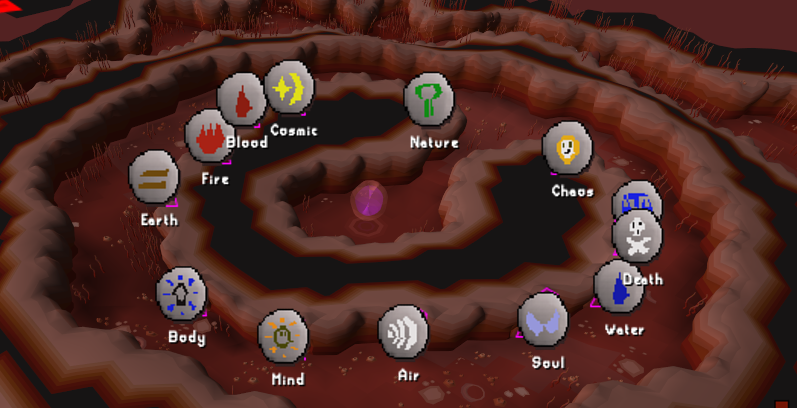
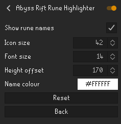

<!-- GSVS-REPOSITORY-MIGRATION -->
> **New repository home:** This project moved from `xboxnuker-rgb/abyss-highlighter` to
> [GSVS-UK-ACM/abyss-highlighter](https://github.com/GSVS-UK-ACM/abyss-highlighter).
> Existing GitHub links redirect here. Continue using this repository under its
> organisation address. Existing local checkouts can keep their folders.

# Abyss Rift Rune Highlighter

Spot the right Abyss exit with a matching rune icon above each rift. Add readable rune names or keep a compact icon-only view.

## Find your rune

Labels cover all 13 exits: air, blood, body, chaos, cosmic, death, earth, fire, law, mind, nature, soul and water. The overlay works alongside RuneLite's built-in Runecraft clickbox and minimap overlays.

## Make the labels your own

| Setting | What it changes | Default |
| --- | --- | --- |
| **Show rune names** | Adds the name beneath each icon; turn off for icons only. | On |
| **Icon size** | Scales icons from 24 to 72 pixels. | 40 |
| **Font size** | Scales names independently, from 10 to 24. | 14 |
| **Height offset** | Moves labels above the rifts, from 80 to 300. | 210 |
| **Name colour** | Changes the optional rune-name text. | White |

For a compact view, turn off names and reduce the icon size. For easier reading at your usual zoom, keep names enabled and adjust font size and height together.

Once enabled, enter the Abyss to see the labels. The plugin draws passive overlays and makes no network requests.

## Installation

Open RuneLite's **Configuration → Plugin Hub**, search for **Abyss Rift Rune Highlighter** and install it. Open the plugin's settings to customise the options above.

[View on the Plugin Hub](https://runelite.net/plugin-hub/show/abyss-rift-rune-highlighter).

## Development

See [development and implementation reference](DEVELOPMENT_REFERENCE.md) for the preserved setup instructions, technical details, testing notes and existing project documentation.

## Support

Enjoy the plugin? [Visit the GSVS UK ACM Patreon shop](https://www.patreon.com/cw/GSVS_UK_ACM/shop) to support the work.
